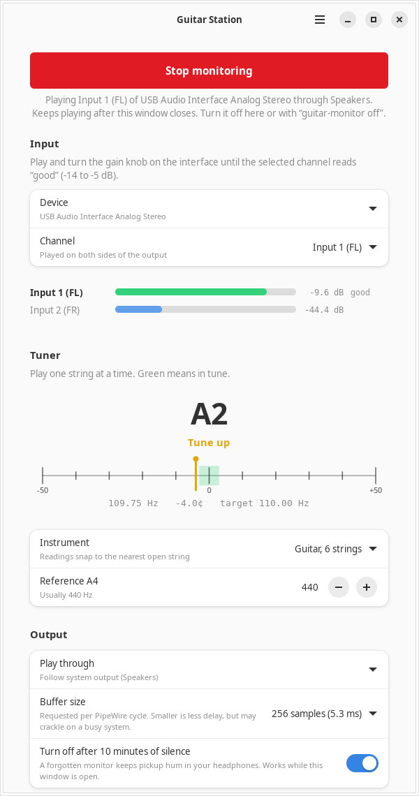
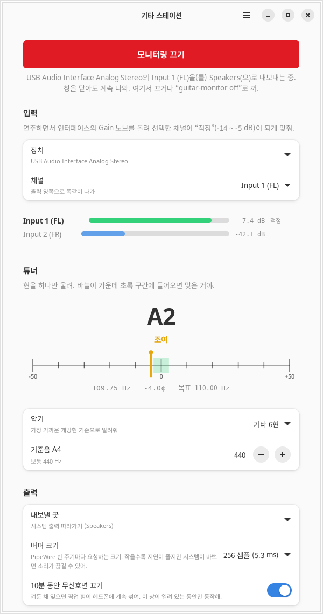

# Guitar Station

A small GTK4 app for Linux that lets you hear a guitar or bass plugged into a USB audio interface through whatever your desktop is playing on. It also shows input meters for setting the gain knob and has a tuner. Everything goes through PipeWire.

<picture>
  <source media="(prefers-color-scheme: dark)" srcset="docs/screenshot-dark.webp">
  
</picture>

I plug a bass or guitar into a PreSonus AudioBox USB 96 on an Ubuntu desktop. Hearing it on my headphones meant wiring `pw-loopback` and `pw-link` by hand every time, the box delivers input 1 on the left channel only, and re-plugging it resets the wiring. This app does that wiring once and keeps it in place.

[한국어 설명은 아래에 있습니다.](#한국어)

## What it does

- **Monitoring with one button.** Pick the interface and the channel your instrument is on; that one channel is played on both sides of the output. Monitoring runs as a systemd user service, so it keeps playing after you close the window, and `guitar-monitor off` stops it from a terminal.
- **Output follows the system default**, or stays on an output you pin. A pinned output is not swapped for another device: if it disappears, monitoring stops.
- **A meter for every channel of the input**, with a plain verdict for the selected one (gain low / good / a bit hot / too hot) and a clipping warning. They run whether monitoring is on or off, so you can set the gain before any sound goes anywhere.
- **Tuner** for 4- and 5-string bass, 6-string guitar or chromatic, with an adjustable A4 (415 to 466 Hz).
- **Optional auto-off** after 10 minutes of silence, because a forgotten monitor keeps pickup hum in your headphones.
- English and Korean UI.

## Install

Tested on Ubuntu 24.04 (PipeWire 1.0.5, WirePlumber 0.4.17, GTK 4.14, libadwaita 1.5).

```sh
sudo apt install python3-gi python3-gi-cairo gir1.2-gtk-4.0 gir1.2-adw-1 \
                 python3-numpy pipewire-bin wireplumber gettext
git clone https://github.com/Jayyo/guitar-station
cd guitar-station
make install                 # into ~/.local; PREFIX=/usr/local also works
```

This installs `guitar-station` (the window) and `guitar-monitor` (the CLI) into `~/.local/bin`, the package into `~/.local/share/guitar-station`, and a desktop entry, so it shows up in the app grid. `make uninstall` removes those again; your settings in `~/.config/guitar-station/` stay.

To run straight from the checkout instead: `./bin/guitar-station` (run `make` first if you want the Korean translation).

## Command line

```console
$ guitar-monitor devices
Inputs:
 * USB Audio Interface Analog Stereo  [FL, FR]
   HD Audio Controller Analog Stereo  [FL, FR]
Outputs:
 d HD Audio Controller Analog Stereo
   Headset Analog Stereo
$ guitar-monitor level 3       # peak per channel over 3 s, verdict for the chosen one
$ guitar-monitor tune 15       # tuner readings in the terminal
$ guitar-monitor on            # start with the settings saved by the app
$ guitar-monitor off
```

## How it works

**Routing.** "Start monitoring" launches a transient user service (`systemd-run --user --collect`) that runs `python3 -m guitarstation.monitor`. That process starts a `pw-loopback` whose capture side has `node.autoconnect=false`, so WirePlumber never wires the interface's stereo pair into it. Once a second it checks the links and makes sure exactly one input port feeds both loopback inputs, and nothing else does. When the interface is re-plugged its links disappear and its node may come back under a different name; the next check finds it again and restores the links. The playback side follows the default sink, or uses `target.object` plus `node.dont-reconnect` for a pinned output, and the same process ends monitoring when that output goes away.

**Buffer size.** The loopback requests `node.latency=<n>/48000`. PipeWire takes such requests into account when it picks the graph's cycle size (within its configured limits), and the request goes away with the loopback; nothing global is changed. On my setup the graph ran at 256 samples while monitoring and went back afterwards. The number in the UI is a requested cycle size, not the end-to-end delay; the interface's own buffers and the output device add to it.

**Device identity.** PipeWire node names change across re-plugs and profile switches (`...analog-stereo`, `...pro-input-0`, `...mono-fallback.2`), so inputs and outputs are remembered by card name plus ALSA PCM device number, falling back to the exact node name (which is all a virtual device has). If the saved channel no longer exists, the app says so instead of picking another one.

**Meters and tuner** share one `pw-cat` capture of the whole device with `stream.dont-remix`, so each channel arrives untouched. The tuner is YIN (de Cheveigné and Kawahara, 2002) with the difference function computed through an FFT: an 8192-sample window plus 1920 samples of lag covers the 30.9 Hz low B of a 5-string bass and costs 1 to 2 ms of numpy per update. Readings are median-smoothed over five estimates. When a new pluck arrives, analysis waits until the window lies entirely after the attack, because a window that straddles it reads several cents off. The first reading appears about a quarter of a second after you start playing.

On synthetic plucked tones (B0 to E4, detuned -20 to +30 cents, with and without a weak fundamental) the steady-state error stays under 1 cent; `tests/test_tuner.py` checks that, along with chunking, re-plucks, silence, noise and stale readings.

## Things I ran into

- The AudioBox USB 96 has no ALSA mixer controls (`amixer -c N` prints nothing). Gain, mix and volume are hardware knobs, which is why the app judges the level instead of setting it.
- `arecord -D hw:N,0` fails with "busy" while PipeWire holds the device. Capture through PipeWire instead.
- Wiring the loopback by hand with `pw-link` worked reliably on PipeWire 1.0.5; setting `audio.position=[MONO]` on the loopback's capture side did not give me input 1 on both sides.
- The same headset showed up as `...iec958-stereo` one day and `...analog-stereo` the next, which is what pushed device matching away from node names.

## Limitations

- Dry signal only: no amp simulation or effects.
- Auto-off only works while the window is open. Monitoring itself keeps running without it.
- Needs a systemd user session (`systemd-run --user`). No Flatpak; the app has to reach the host's PipeWire graph and user manager.
- The multi-device and multi-channel code was tested against virtual PipeWire devices (2- and 4-channel); the original single-device version was used with an AudioBox USB 96. Reports from other interfaces are welcome.
- The screenshots show a synthesized A string on a virtual input.

## Development

```sh
sudo apt install python3-pytest
make check      # pytest: tuner, PipeWire parsing, config, unit command line, CLI
make pot        # refresh po/guitar-station.pot after changing UI strings
```

The core (`pw.py`, `core.py`, `tuner.py`, `monitor.py`) has no GTK dependency. `GUITAR_STATION_UNIT` changes the systemd unit name, which keeps test runs away from a real monitoring session.

## License

MIT, see [LICENSE](LICENSE).

---

## 한국어

USB 오디오 인터페이스에 꽂은 기타·베이스 소리를 데스크톱의 현재 출력(헤드폰, 스피커)으로 바로 들려주는 리눅스 GTK4 앱입니다. 게인 노브를 맞추기 위한 채널별 레벨 미터와 튜너가 함께 있습니다. PipeWire 기반입니다.

PreSonus AudioBox USB 96으로 베이스를 칠 때마다 `pw-loopback`과 `pw-link`를 손으로 연결해야 했고, 이 인터페이스는 Input 1을 왼쪽 채널로만 보내며, USB를 다시 꽂으면 연결이 초기화됐습니다. 그 과정을 버튼 하나로 줄이려고 만들었습니다.

- 인터페이스와 악기가 꽂힌 채널을 고르면 그 채널 하나를 출력 양쪽으로 똑같이 보냅니다. 모니터링은 systemd 사용자 서비스로 돌아서 창을 닫아도 계속 나오고, 터미널에서 `guitar-monitor off`로 끌 수 있습니다.
- 출력은 시스템 기본 장치를 따라가거나 특정 장치에 고정할 수 있습니다. 고정한 장치가 사라지면 다른 장치로 넘어가지 않고 모니터링을 끕니다.
- 레벨 미터는 모니터링이 꺼져 있어도 동작하므로 소리를 내보내기 전에 게인을 맞출 수 있습니다.
- 튜너는 베이스 4·5현, 기타 6현, 크로매틱 프리셋과 기준음 A4 조절을 지원합니다.

설치는 위의 [Install](#install)과 같습니다. 시스템 언어가 한국어이면 `make install` 후 한국어 화면으로 뜹니다(소스에서 바로 실행할 때는 `make`로 번역을 먼저 빌드).


